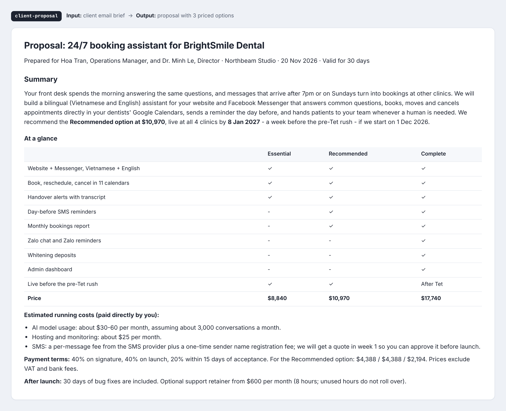
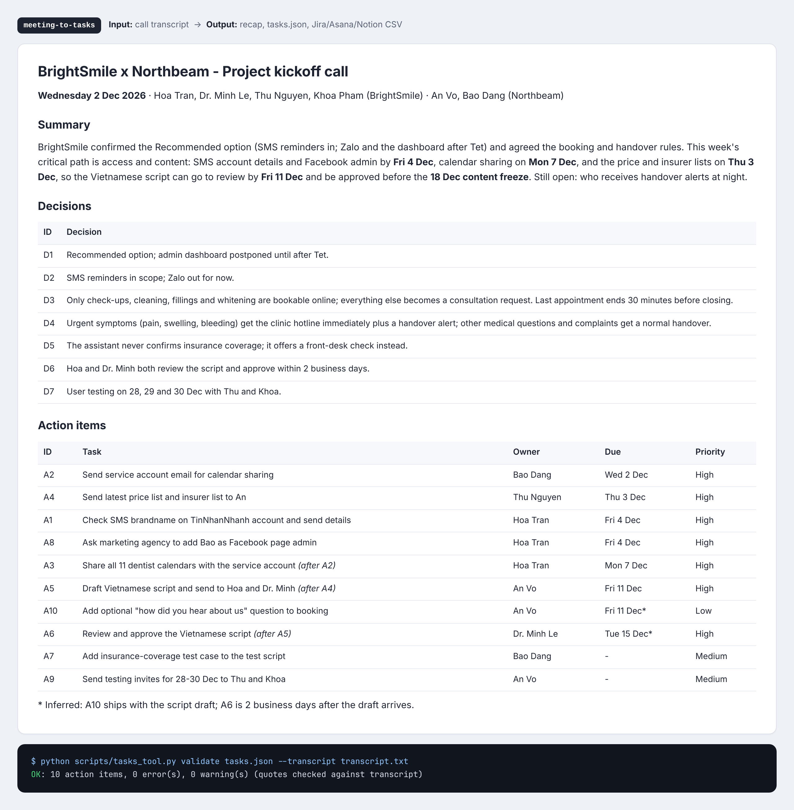
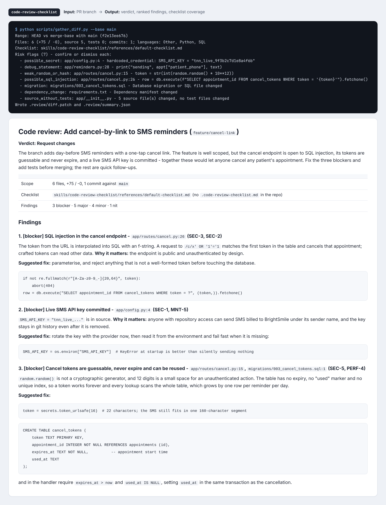
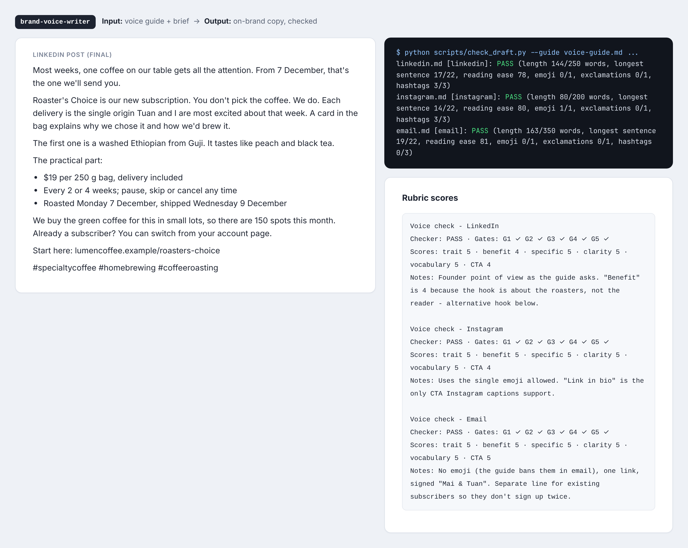
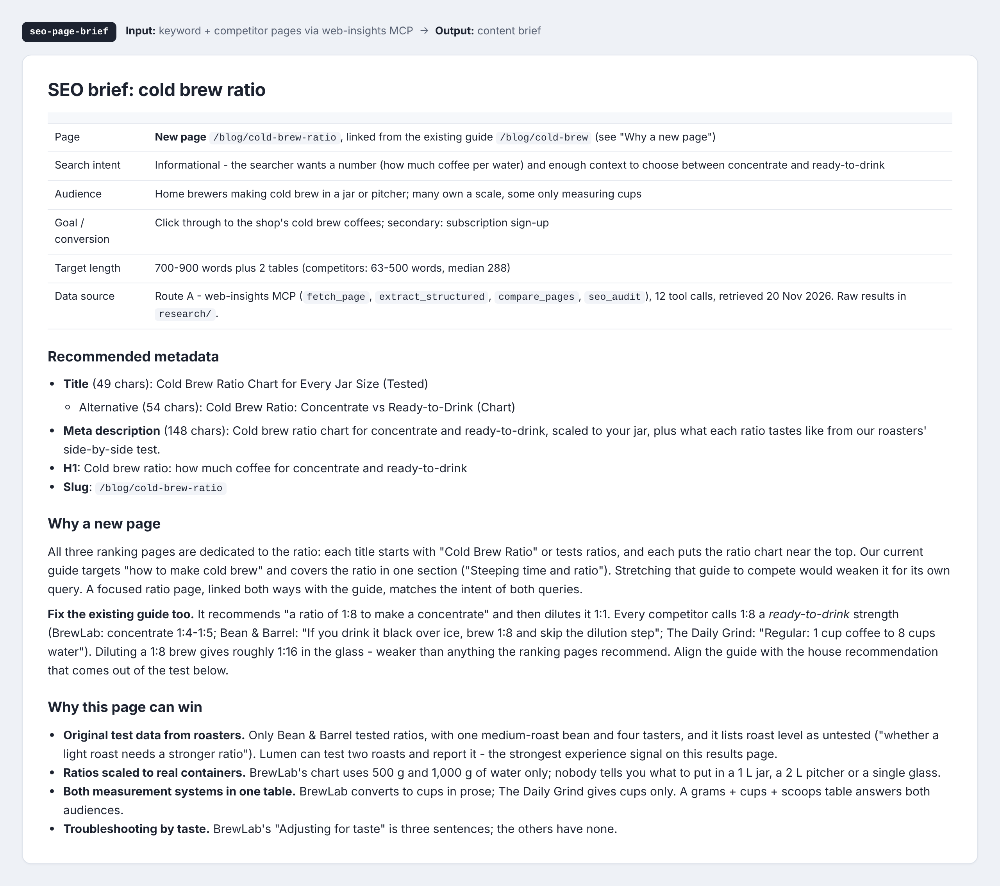
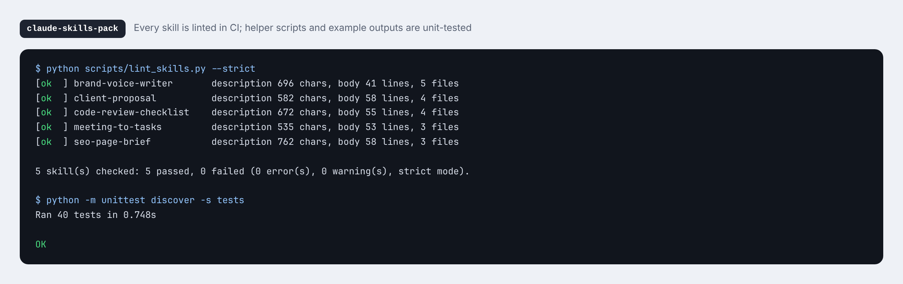

# claude-skills-pack

**Five production-ready Agent Skills that teach Claude your team's way of doing recurring business work** - proposals, meeting follow-ups, code reviews, on-brand copy and SEO briefs - with templates, deterministic helper scripts, a CI linter and real worked examples.

   -blue) 



## What and why

An [Agent Skill](https://platform.claude.com/docs/en/agents-and-tools/agent-skills/overview) is a folder with a `SKILL.md` (instructions plus YAML frontmatter) and optional scripts, references and templates. Claude sees only each skill's name and description until a task matches; then it loads the instructions and the files it needs. That makes skills the cheapest way to make Claude consistent at work your team repeats: the house style, the checklist and the tooling live in version control instead of in someone's prompt history.

Each skill here follows the same principles:

- **Grounded, not invented.** Proposals label assumptions, action items need a verbatim quote from the meeting, SEO briefs cite fetched page data, copy may only use facts from the brief.
- **Deterministic where it matters.** Validation, CSV export, diff collection and voice checks are Python scripts (standard library only), so the same input always gets the same verdict.
- **Customisable without touching the instructions.** Teams edit a style guide, a checklist or a voice guide; the `SKILL.md` stays generic.

## The skills

| Skill | What it does | Bundled resources |
|---|---|---|
| [`client-proposal`](skills/client-proposal) | Client brief, RFP or call notes → proposal in house style: scope (in/out), deliverables, timeline, priced options, assumptions, risks, next steps; plus cover email and open questions. | Proposal template, house style guide, pricing guidance |
| [`meeting-to-tasks`](skills/meeting-to-tasks) | Transcript or notes → decisions, action items (owner, due date, priority, evidence quote), open questions as Markdown + JSON; validated, then exported to Jira, Asana, Notion or generic CSV. | `tasks_tool.py` (validate, quote-check against transcript, export), output schema |
| [`code-review-checklist`](skills/code-review-checklist) | Branch, PR, staged changes or pasted diff → verdict, severity-ranked findings with file:line and fixes, checklist coverage table. Teams override the checklist with `.code-review-checklist.md`. | `gather_diff.py` (diff, stats, commit list, risk flags: secrets, SQL/shell injection patterns, debug code, untested source...), default checklist, review template |
| [`brand-voice-writer`](skills/brand-voice-writer) | Voice guide + brief → on-brand LinkedIn/X/Instagram posts, emails, newsletters, product and ad copy, each scored before hand-over. Can build the voice guide from example texts. | `check_draft.py` (banned words, sentence length, emoji, hashtags, reading ease, channel limits), voice-guide template, self-check rubric, channel formats |
| [`seo-page-brief`](skills/seo-page-brief) | Keyword + competitor URLs → content brief: intent, title/meta/H1/slug, outline, consensus topics, content gaps, length target, FAQs, internal links, schema, competitor table. Uses the [web-insights MCP server](#works-with-web-insights-mcp) when connected. | Brief template, web-insights tool recipes |

## Examples (real work, not mock-ups)

The [`examples/`](examples) folder contains real inputs and the outputs produced by following each skill, including the helper scripts' actual output. All businesses and people are fictional.

| | |
|---|---|
|  |  |
|  |  |

- **client-proposal** - a dental chain's email brief becomes a 3-option proposal; tables are machine-checked to add up ([output](examples/client-proposal/output/proposal-brightsmile-dental.md)).
- **meeting-to-tasks** - a kickoff call transcript becomes 7 decisions, 10 action items and 3 open questions; every quote is verified against the transcript and the Jira/Asana/Notion CSVs are generated by the script ([output](examples/meeting-to-tasks/output/tasks.md)).
- **code-review-checklist** - a Flask PR adding SMS cancel links gets 13 findings, including SQL injection, a committed API key and guessable tokens; all 7 automated risk flags are confirmed or dismissed ([output](examples/code-review-checklist/output/REVIEW.md), reproducible with [`reproduce.sh`](examples/code-review-checklist/reproduce.sh)).
- **brand-voice-writer** - three launch pieces for a coffee subscription; the checker failed two first drafts for over-long sentences and the rubric caught one invented claim, both fixed ([voice check](examples/brand-voice-writer/output/voice-check.md)).
- **seo-page-brief** - 12 web-insights MCP calls on three competitor pages produce a brief that also catches a contradiction on the brand's own page ([brief](examples/seo-page-brief/output/brief-cold-brew-ratio.md)).

## Install

Requirements: none for the instructions themselves. Helper scripts need Python 3.9+ (standard library only); `code-review-checklist` also needs git.

### Claude Code

Skills are discovered from `~/.claude/skills/` (personal, every project) or `.claude/skills/` inside a repository (shared with the team through git).

```bash
git clone <this repo> claude-skills-pack
mkdir -p ~/.claude/skills
cp -r claude-skills-pack/skills/* ~/.claude/skills/            # all five, for you
# or, for one project and everyone who clones it:
mkdir -p .claude/skills && cp -r claude-skills-pack/skills/meeting-to-tasks .claude/skills/
```

Start a new Claude Code session and ask naturally ("turn these notes into Jira tickets", "review my branch before I merge"). Ask "what skills are available?" to confirm they loaded.

### Claude.ai (and Claude Desktop)

Package each skill as a zip with the skill folder at the root:

```bash
python3 scripts/package_skills.py            # lints, then writes dist/<skill>.zip
```

Upload the zip in Claude.ai under **Settings → Capabilities → Skills** (custom skills must be enabled for your plan or organisation; the menu location may change as the product evolves). Code execution must be enabled for the helper scripts to run.

### Claude API

Upload a skill with the Skills API, then attach it to Messages API requests through the code execution container. With the Python SDK:

```python
import anthropic
from anthropic.lib import files_from_dir

client = anthropic.Anthropic()

skill = client.skills.create(files=files_from_dir("skills/meeting-to-tasks"))

response = client.messages.create(
    model="claude-opus-5-5",
    max_tokens=16000,
    container={"skills": [{"type": "custom", "skill_id": skill.id, "version": "latest"}]},
    tools=[{"type": "code_execution_20250825", "name": "code_execution"}],
    messages=[{"role": "user", "content": "Turn these meeting notes into action items and a Jira CSV: ..."}],
)
```

Or with cURL (each file's name must include the skill folder):

```bash
curl -X POST https://api.anthropic.com/v1/skills \
  -H "x-api-key: $ANTHROPIC_API_KEY" -H "anthropic-version: 2026-10-21" \
  -F "files[]=@skills/meeting-to-tasks/SKILL.md;filename=meeting-to-tasks/SKILL.md" \
  -F "files[]=@skills/meeting-to-tasks/references/output-schema.md;filename=meeting-to-tasks/references/output-schema.md" \
  -F "files[]=@skills/meeting-to-tasks/scripts/tasks_tool.py;filename=meeting-to-tasks/scripts/tasks_tool.py"
```

Custom skills are shared across the whole API workspace they are uploaded to. See Anthropic's [Skills guide](https://platform.claude.com/docs/en/build-with-claude/skills-guide) for versioning and limits.

## Customise for your team

| Skill | Edit this | Typical changes |
|---|---|---|
| client-proposal | `references/style-guide.md`, `assets/proposal-template.md` | Studio name, day rates, contingency, payment terms, voice, section order |
| meeting-to-tasks | `references/output-schema.md` | Priority scale, labels, extra CSV columns |
| code-review-checklist | `.code-review-checklist.md` in *your* repository (copy `references/default-checklist.md`) | Team rules, framework-specific items, sections marked `(n/a)` |
| brand-voice-writer | Your voice guide (from `assets/voice-guide-template.md`) | Traits, vocabulary, banned words, channel rules in the `voice-rules` block |
| seo-page-brief | `assets/brief-template.md` | Brief sections your writers expect |

## Quality checks

```bash
pip install -r requirements-dev.txt          # PyYAML, for the linter
python3 scripts/lint_skills.py --strict      # lint every skill
python3 -m unittest discover -s tests        # 40 tests: linter, scripts, example consistency
python3 scripts/package_skills.py            # build upload zips into dist/
```



`lint_skills.py` checks what breaks skills in practice: frontmatter present and valid YAML; only allowed keys (`name`, `description`, `license`, `allowed-tools`, `metadata`, `compatibility`); name in kebab-case, at most 64 characters, matching the folder and free of reserved words; description present, at most 1,024 characters, no angle brackets, long enough and containing trigger guidance; body under 500 lines; every file referenced from `SKILL.md` exists; every bundled file is referenced; bundled Python compiles; exactly one `SKILL.md`; under the 30 MB upload limit. GitHub Actions runs the linter in strict mode, the tests and the packager on every push and pull request ([`ci.yml`](.github/workflows/ci.yml)).

## Works with web-insights-mcp

`seo-page-brief` is designed to pair with **web-insights-mcp**, a companion MCP server (separate repository) that provides `fetch_page`, `crawl_site`, `seo_audit`, `site_seo_audit`, `extract_structured` and `compare_pages` with SSRF protection. The SEO example's research was recorded through that server; without it, the skill falls back to any web fetch tool or pasted content.

## Security notes

- Helper scripts are read-only: `gather_diff.py` never modifies the repository, and the other scripts only write the files you name. No script makes network calls.
- `gather_diff.py` reports *possible* secrets with the matched line so a reviewer can act; avoid pasting its output into public places when it flags a real credential.
- Skills are instructions Claude follows. Review any skill (including these) before installing it, as you would a dependency, and only install skills from sources you trust.
- On the API, custom skills are visible to everyone with access to the workspace; keep sensitive house data (rates, client names) out of shared workspaces.

## Limitations (honest list)

- **Skill quality depends on the model and context.** The scripts are deterministic; the writing and judgement are not. The rubric and validators reduce, but do not eliminate, mistakes - keep a human in the loop for anything sent to clients.
- **Triggering was not measured with an automated eval.** Descriptions follow Anthropic's skill-authoring guidance (what + when, specific trigger phrases), and the examples were produced by following each `SKILL.md` step by step, but no trigger-rate benchmark was run.
- **Examples use fictional data.** The SEO example's competitor pages are fictional fixtures served locally (the build environment had no internet access); the method is the same for live pages.
- **Risk flags are heuristics.** `gather_diff.py` uses regular expressions; it misses obfuscated secrets and can flag safe code. It is a checklist for the reviewer, not a security scanner.
- **Tracker imports vary.** CSV columns follow each tool's importer conventions at the time of writing; you may still need to map fields in the import wizard (Jira date format, Asana assignee emails, Notion property types).
- **Reading ease is English-only.** `check_draft.py`'s readability score and syllable counter assume English text.

## License

MIT © Cuong Nguyen

---

Built by NQC The Dev — AI developer. Available for hire on Fiverr: https://www.fiverr.com/cuongnqxx
